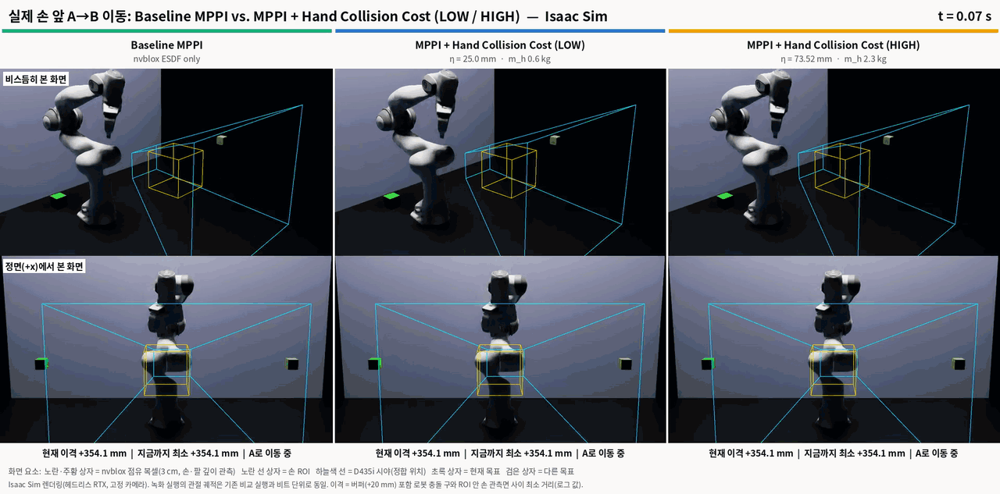
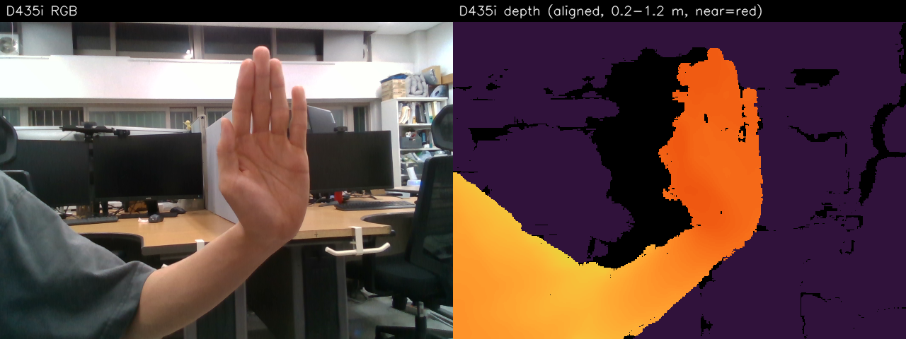
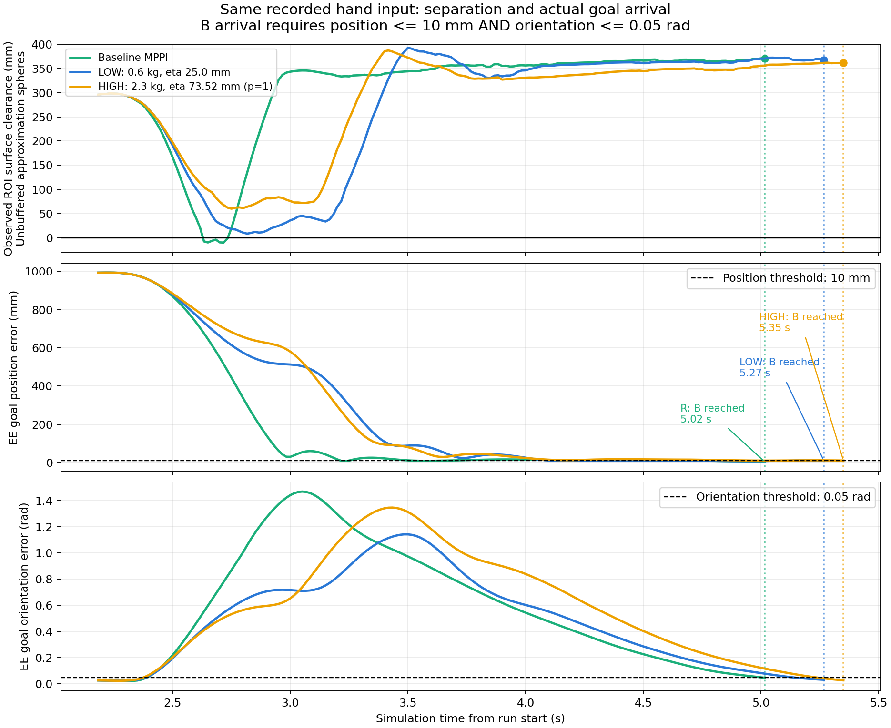
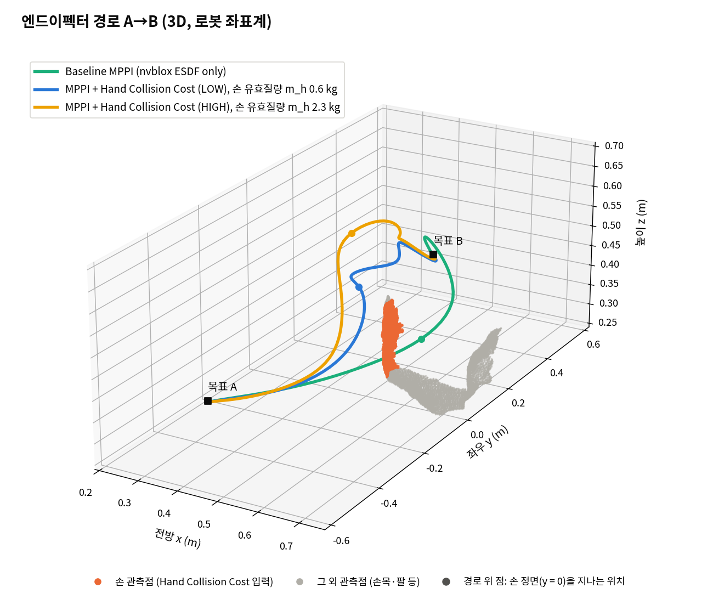
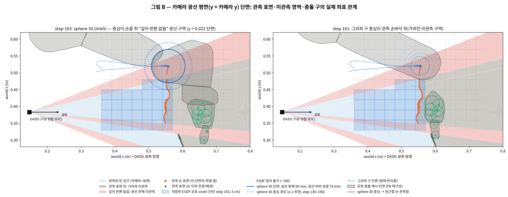
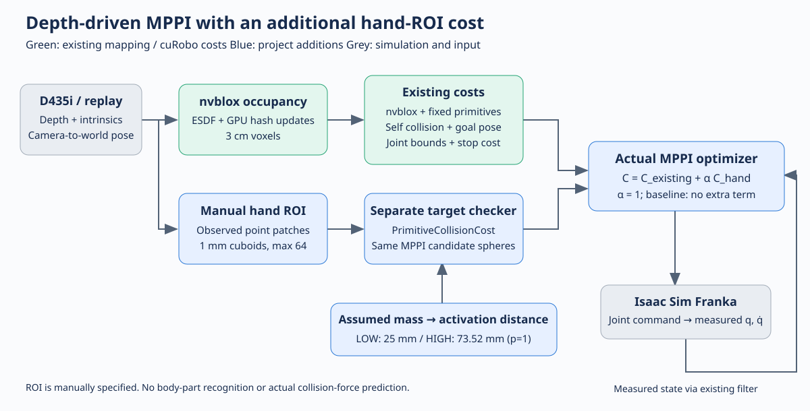

# Franka Depth MPPI: 손 ROI 근접 비용과 가정 유효질량에 따른 회피 비교

franka-depth-mppi는 깊이 영상의 손 관측에 근접 비용을 더해, 가정한 손 유효질량에 따라 Isaac Sim Franka의 회피 경로가 어떻게 달라지는지 비교한 프로젝트다.



*세 조건의 Franka A→B 이동을 0.5배속으로 재생한 장면이다(시뮬레이션 6.3 s). 왼쪽부터 Baseline MPPI, LOW, HIGH이고 위는 비스듬히, 아래는 정면(+x)에서 본 화면이다.*

D435i 깊이 영상을 nvblox 지도에 반영하고 Isaac Sim의 Franka를 NVIDIA GPU MPC 라이브러리의 MPPI 기반 MPC로 움직인다. 기존 환경 비용에 **손 ROI 관측 패치의 근접 비용**을 더해, 가정한 손 유효질량에 따른 비용 활성 거리와 이동 경로의 관계를 비교했다. 대표 결과는 **같은 정적 손 깊이 기록을 입력으로 쓰는 A→B 이동 실험**이다. 라이브 지도 갱신과 왕복 실행 기능도 코드에 들어 있다.

이 프로젝트에서 더한 것:

- **손 관측 패치 비용**: 수동 손 ROI에서 관측 패치를 뽑고 대상 전용 checker로 거리를 계산한다.
- **optimizer 연결**: 추가 대상 비용을 실제 optimizer rollout에 합산하고 CUDA graph 연결을 검증했다.
- **같은 입력 재생**: 깊이를 기록해 모든 조건에 같은 입력으로 재생하고 실제 EE 도달로 목표를 바꾼다.
- **질량 → 활성 거리**: 가정 질량을 활성 거리로 바꾸는 휴리스틱, 비용·거리 평가, 실패 원인 진단.

> **후속 확장 프로젝트**
> - [effmass-mpc](https://github.com/ukhyeon/effmass-mpc): 이 프로젝트에서 가정값으로 둔 손 유효질량 대신 SMPL 사람 모델에서 계산한 분절별·방향별 유효질량을 쓰고, 그에 따라 회피 구역의 모양이 달라지는 MPC로 확장했다 (Isaac Sim, Franka FR3).
> - [effmass-mpc-franka](https://github.com/ukhyeon/effmass-mpc-franka): 같은 MPC를 실물 Franka FR3에서 실시간 RGB-D 사람 인식과 함께 60 Hz로 실행한다 (ros2_control 브리지, Ruckig 1 kHz).

## 1. 결과

### 입력



같은 안정 HOLD 구간의 **236개 깊이 프레임 / 472 시뮬레이션 스텝 / seed 0**을 조건마다 새 지도·solver·로봇에서 재생했다. 기록된 가상 카메라 변환을 모든 조건에 똑같이 적용했다. 공개 입력은 깊이 NPZ와 메타데이터이고 위 RGB는 그 구간을 설명하기 위한 한 장이다.

### 조건

로봇 유효질량 `m_r=5kg`, 손 유효질량 `m_h=0.6/2.3kg`은 **실험 가정값**이다.

```text
mu(m_h) = 5*m_h / (5+m_h)
eta(m_h, p) = 0.025 * (mu(m_h)/mu(0.6))**p  [m]
```

HIGH는 **p=1 민감도 설정**이다(초기 p=0.5 정책에서는 HIGH=42.87 mm). LOW는 두 지수 모두 25 mm다. alpha=1, 대상 비용 weight=100000, 기존 환경 비용 활성 거리 25 mm와 나머지 MPPI 설정은 그대로 두었다. 활성 거리는 추가 비용이 작동하기 시작하는 거리다.

### 결과 표

| 조건 | 추가 대상 eta | 최소 거리: 버퍼 제외 | 최소 거리: 버퍼 포함 | A→B 이동 시간 | B 도달 위치 / 자세 오차 |
|---|---:|---:|---:|---:|---:|
| Baseline R | 추가 비용 없음 | −9.54 mm | −29.54 mm | 2.833 s | 2.44 mm / 0.0475 rad |
| LOW, 0.6 kg | 25.00 mm | +8.80 mm | −11.20 mm | 3.083 s | 9.77 mm / 0.0321 rad |
| HIGH, 2.3 kg, p=1 | 73.52 mm | +60.43 mm | +40.43 mm | 3.167 s | 9.89 mm / 0.0282 rad |

실제 EE가 위치 ≤ 10 mm **및** 자세 ≤ 0.05 rad를 모두 만족해야 도달로 기록한다. A에 도달한 다음 스텝에 B를 지령했고 세 조건 모두 B에 도달했다. 시간은 모두 시뮬레이션 시간이다.

맨 위 영상 아래 자막의 이격 거리는 **20 mm 계획 버퍼를 포함한 값**이라서 표·그래프의 버퍼 제외 값보다 20 mm 작다. 가상 로봇에 실측 깊이 관측을 정합한 실험이다. [원본 영상(mp4)](docs/media/isaac-comparison.mp4) · [정지 화면과 위에서 본 EE 경로](docs/images/2-isaac-and-top-path-baseline-LOW-HIGH.png): 정지 화면은 t=2.73 s, EE 경로는 t=3.88 s까지의 로그 기반 누적 경로다. 이 그림의 거리는 **20 mm 계획 버퍼를 제외한 근사 충돌 구 표면–ROI 손 관측점** 기준이고 머리글의 최소 거리는 각 조건의 A→B 전체 구간 최솟값이다.



그래프는 모든 조건에 같은 시간축을 쓴다. 조건마다 B 도달 시점까지 표시하므로 끝나는 시각이 다르다. 원본 로그는 모두 같은 472스텝이고 관측점이 없는 스텝은 결측으로 처리했다. [비교 CSV](docs/data/comparison.csv) · [시계열 CSV](docs/data/timeseries.csv)

- **R→LOW:** 손 관측 패치 표현과 추가 페널티를 함께 도입한 효과다.
- **LOW→HIGH:** 같은 표현에서 활성 거리를 25→73.52 mm로 바꾼 데 따른 행동 차이다. 이 장면에서 최소 이격은 약 51.63 mm 늘고 A→B 시간은 약 0.083 s 늘었다.
- 활성 거리를 바꾸면 비용의 크기와 기울기도 함께 바뀐다. 결과는 단일 장면·단일 seed 기준이다.

### 손 주변 3D 엔드이펙터 경로



실제 관절/EE 로그에서 재구성한 A→B 경로다. 주황 점은 Hand Collision Cost에 들어간 손 관측점이고 경로 위의 점은 손 정면(y=0)을 지나는 위치다. 손 정면을 지날 때 Baseline은 손 관측점 가까이를 낮게 지나가고 LOW와 HIGH는 로봇 쪽으로 물러나며 더 높이 지나간다. 가장 높고 멀리 돌아가는 조건은 HIGH다.

<details>
<summary>Baseline 실패 원인</summary>



**R에도 nvblox 환경 충돌 비용이 있다.** 다만 step163에서 손 관측면과 겹친 panda_link5의 구 중심이 미관측 ESDF에 있어 해당 비용이 0이었다. 실제 optimizer 후보에서도 이 공백을 확인했다. 따라서 R→LOW 개선에는 질량 정책 외에 손 관측 패치 표현의 효과도 함께 들어 있다. [원인 진단과 증거](docs/diagnosis.md)

</details>

## 2. 구현 구조



| 기존 기능 재사용 | 이 프로젝트에서 추가·연결한 부분 |
|---|---|
| NVIDIA GPU MPC 라이브러리의 MPPI 후보 생성·로봇 운동학·기본 비용 | 수동 손 ROI의 관측 패치 추출과 대상 전용 checker |
| nvblox occupancy/ESDF·충돌 질의 | 실제 optimizer rollout에 추가 대상 비용 합산, CUDA graph 연결 검증 |
| Isaac Sim Franka·D435i SDK | 깊이 기록·같은 입력 재생, 실제 EE 도달 기반 목표 전환 |
| 라이브러리의 PrimitiveCollisionCost | 가정 질량→활성 거리 휴리스틱, 비용·거리 평가와 실패 원인 진단 |

비용 합산은 `C_total[b,t] = C_existing[b,t] + alpha * C_hand[b,t]`다. [구현 파일과 비용 정의](docs/method.md)

## 3. 요구 사항과 재현

Isaac Sim 4.5.0 / Python 3.10.15 / PyTorch 2.5.1+cu118 / CUDA 11.8 / cuRobo 0.7.7 / nvblox와 nvblox_torch ABI=0 환경, RTX 4060 Ti 8GB에서 검증했다. 이 환경은 따로 준비해야 한다. [환경·commit·실행 안내](docs/reproduction.md)

1. 설치 경로 파일을 만들고 `.env.local`에 기존 Isaac Sim / cuRobo / ABI=0 설치 경로를 적는다.
   ```bash
   cp .env.example .env.local
   ```
2. 세 조건을 카메라 없이 포함된 기록 입력으로 재생한다. 결과는 `experiment/results/`의 새 timestamp 폴더에 저장되고 기존 증거는 `evidence/`에 그대로 남는다.
   ```bash
   bash scripts/replay.sh R
   bash scripts/replay.sh LOW
   bash scripts/replay.sh HIGH  # 명시적으로 --eta-exponent 1.0 적용
   ```
3. GPU 없이 포함 로그의 그림·표만 다시 만들고 묶음을 검증한다(numpy, matplotlib 필요).
   ```bash
   python3 scripts/build_figures.py
   python3 scripts/verify_bundle.py
   ```

## 4. 저장소 구조

```text
experiment/     검증된 제어·관측·추가 비용 코드
scripts/        경로 설정, 조건별 재생, 그림 생성, 묶음 검증
data/           236프레임 기록 깊이와 메타데이터
evidence/       R / LOW / HIGH 원본 실행의 관절·명령·비용 설정·도달 로그
docs/           비용 정의, 재현, 원인 진단, 그림과 CSV
```

## 5. 한계

- 손 ROI는 수동으로 지정했고 유효질량은 가정값이며 실험은 시뮬레이션 로봇에서 진행했다.
- 거리 수치는 관측된 ROI 점과 근사 구 모델 기준이다.
- LOW의 버퍼 제외 거리는 양수지만 **20 mm 계획 버퍼 포함 거리는 음수**다.
- 손끝 위에서 깊이가 반환되지 않고 손바닥 뒤가 가려져 nvblox 기본 비용에 관측 공백이 생겼다.
- 공개 스크립트는 기존 제어 코드의 복사본이며 배포를 위해 실행 경로만 바꿨다.

## 6. 라이선스와 출처

[그림 출처와 거리 기준](docs/figures.md) · [upstream 및 기여 구분](THIRD_PARTY.md) · [원본 파일 해시](docs/data/provenance.json)

cuRobo 유래 코드의 저작권 표기를 유지했으며 저장소에 upstream [NVIDIA License](LICENSE)를 포함했다. 해당 코드의 연구·평가 목적 사용 제한을 포함한 라이선스 조건을 따른다.
