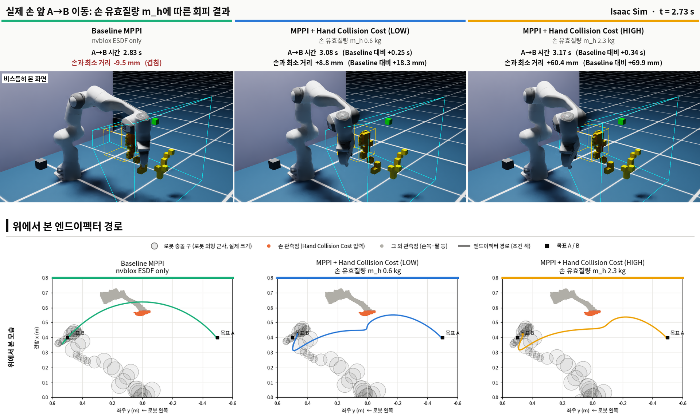
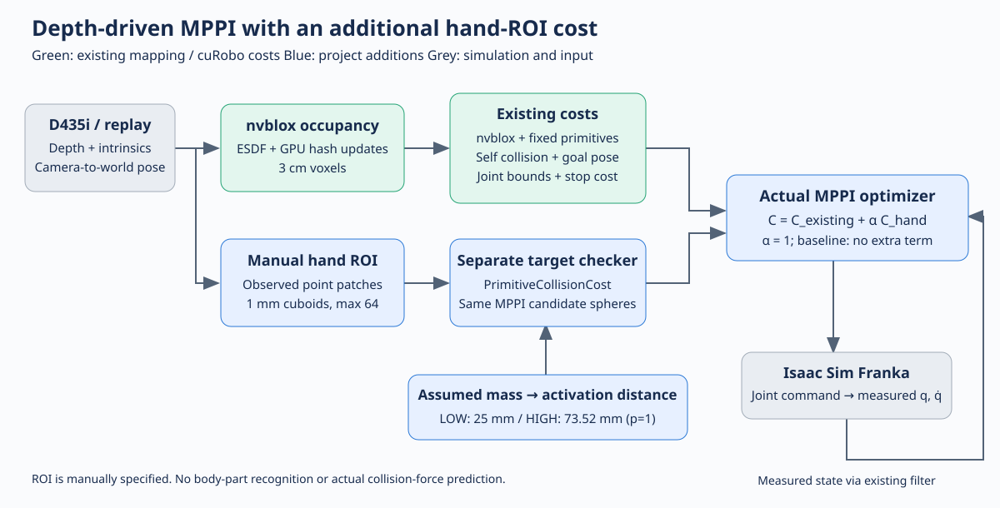
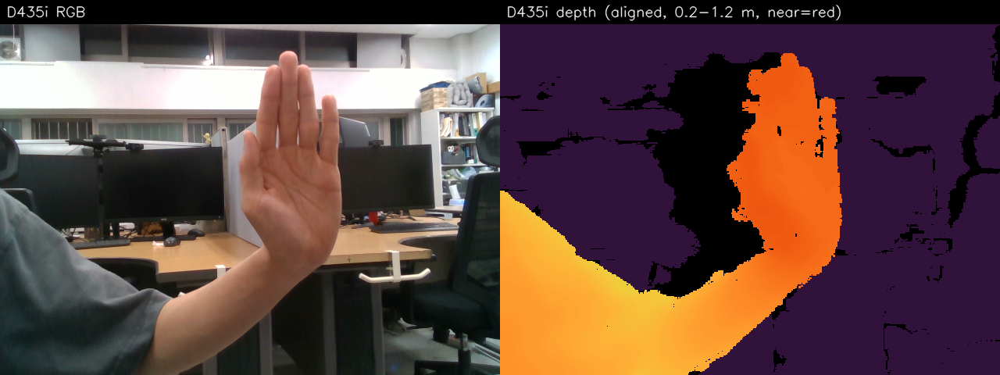
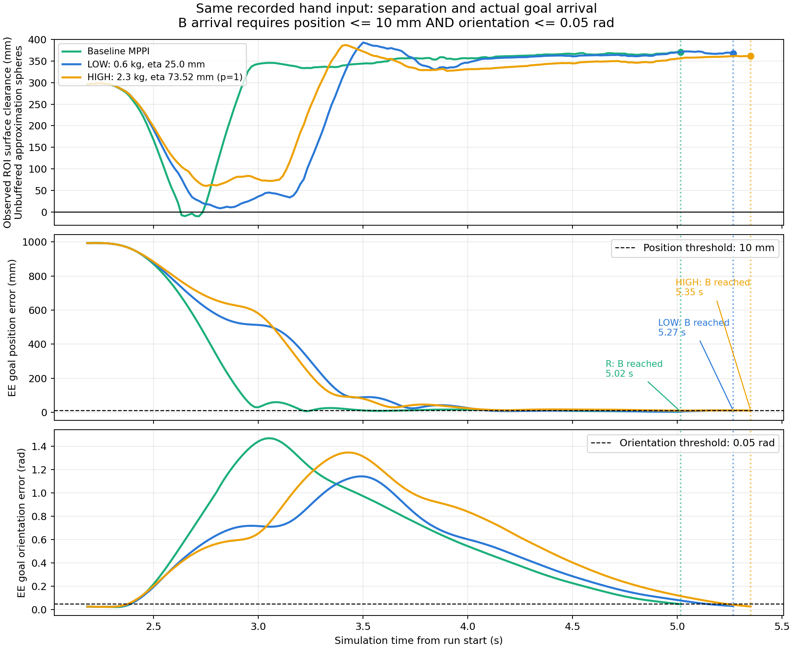
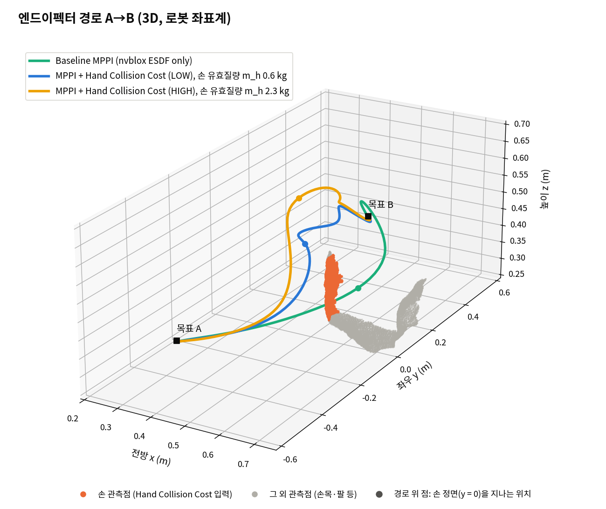
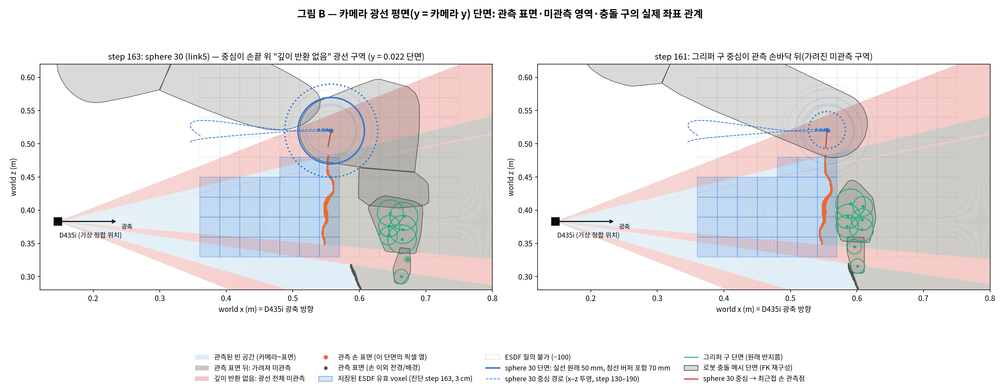

# Franka Depth MPPI — 손 ROI 비용과 유효질량 조건별 회피 비교

D435i 깊이 영상을 nvblox 지도에 반영하고, Isaac Sim의 Franka를 cuRobo MPPI 기반 MPC로 움직입니다. 기존 환경 비용에 **손 ROI 관측 패치의 근접 비용**을 추가해, 가정한 손 유효질량에 따른 비용 활성 거리와 이동 경로의 관계를 비교했습니다.

대표 결과는 **동일하게 기록된 정적 손 깊이 입력을 사용하는 A→B 이동 실험**입니다. 라이브 지도 갱신과 왕복 실행 기능도 코드에 포함되지만, 아래 결과를 이동하는 손에 대한 회피 또는 반복 왕복 성능 검증으로 확대하지 않습니다.



위: Isaac Sim 녹화 t=2.73s. 아래: t=3.88s까지의 로그 기반 누적 EE 경로. 머리글의 최소 거리는 각 조건의 A→B 전체 구간 최솟값이며, 화면 한 시점의 거리가 아닙니다. 거리는 **20mm 계획 버퍼를 제외한 근사 충돌 구 표면–ROI 손 관측점** 기준입니다. 가상 로봇과 실측 깊이 관측을 정합한 실험이며 실제 로봇을 구동하지 않습니다.

[Isaac Sim 비교 영상](docs/media/isaac-comparison.mp4) — 영상 자막은 **20mm 버퍼 포함 거리**를 사용합니다. 본문 대표 사진·그래프의 버퍼 제외 값보다20mm 작습니다.

## 구현 구조와 기여



| 기존 기능 재사용 | 이 프로젝트에서 추가·연결한 부분 |
|---|---|
| cuRobo MPPI 후보 생성·로봇 운동학·기본 비용 | 수동 손 ROI의 관측 패치 추출과 대상 전용 checker |
| nvblox occupancy/ESDF·충돌 질의 | 실제 optimizer rollout에 추가 대상 비용 합산, CUDA graph 연결 검증 |
| Isaac Sim Franka·D435i SDK | 깊이 기록·동일 입력 재생, 실제 EE 도달 기반 목표 전환 |
| cuRobo의 PrimitiveCollisionCost | 가정 질량→활성 거리 휴리스틱, 비용·거리 평가 및 실패 원인 진단 |

비용 합산은 `C_total[b,t] = C_existing[b,t] + alpha * C_hand[b,t]`입니다. MPPI나 새로운 충돌 커널을 직접 개발한 프로젝트는 아닙니다. [구현 파일과 비용 정의](docs/method.md)

## 실측 입력



동일 안정 HOLD 구간의 **236개 깊이 프레임 / 472 시뮬레이션 스텝 / seed 0**을 조건별로 새 지도·solver·로봇에서 재생했습니다. 원시 깊이를 임의 이동하지 않고, 기록된 가상 카메라 변환을 모든 조건에 동일하게 적용했습니다. 공개 입력에는 RGB 동영상 없이 깊이 NPZ와 메타데이터가 포함됩니다. 위 RGB는 해당 구간의 설명용 한 장입니다.

## 조건과 결과

로봇 유효질량 `m_r=5kg`, 손 유효질량 `m_h=0.6/2.3kg`은 **실험 가정값**입니다.

```text
mu(m_h) = 5*m_h / (5+m_h)
eta(m_h, p) = 0.025 * (mu(m_h)/mu(0.6))**p  [m]
```

최종 그림의 HIGH는 **p=1 민감도 설정**입니다. 초기 p=0.5 정책의 HIGH=42.87mm와 다릅니다. LOW는 두 지수 모두 25mm입니다. alpha=1, 대상 비용 weight=100000, 기존 환경 비용 활성 거리25mm와 나머지 MPPI 설정은 유지했습니다. 활성 거리는 보장된 안전거리나 실제 이격 목표가 아닙니다.

| 조건 | 추가 대상 eta | 최소 거리: 버퍼 제외 | 최소 거리: 버퍼 포함 | A→B 이동 시간 | B 도달 위치 / 자세 오차 |
|---|---:|---:|---:|---:|---:|
| Baseline R | 추가 비용 없음 | −9.54mm | −29.54mm | 2.833s | 2.44mm / 0.0475rad |
| LOW, 0.6kg | 25.00mm | +8.80mm | −11.20mm | 3.083s | 9.77mm / 0.0321rad |
| HIGH, 2.3kg, p=1 | 73.52mm | +60.43mm | +40.43mm | 3.167s | 9.89mm / 0.0282rad |

실제 EE가 위치≤10mm **및** 자세≤0.05rad를 만족해야 도달로 기록합니다. A 도달 다음 스텝에 B를 지령했고, 세 조건 모두 B에 도달했습니다. 시간은 벽시간이 아닌 시뮬레이션 시간입니다.



그래프는 모든 조건에 같은 시간축을 사용합니다. 조건별 B 도달 시점까지 표시하므로 끝나는 시각은 다릅니다. 원본 로그는 모두 동일한472스텝입니다. 관측점이 없으면 결측으로 처리하며, EE 경로를 거리 측정 대상으로 사용하지 않습니다. [비교 CSV](docs/data/comparison.csv) · [시계열 CSV](docs/data/timeseries.csv)

- **R→LOW:** 손 관측 패치 표현과 추가 페널티를 함께 도입한 효과입니다.
- **LOW→HIGH:** 같은 표현에서 활성 거리25→73.52mm 변경에 따른 행동 차이입니다. 이 장면에서 최소 이격은 약51.63mm 늘고 A→B 시간은 약0.083s 늘었습니다.
- 질량을 로봇/손에서 추정한 것이 아니며, 활성 거리 변화는 비용 크기와 기울기도 바꿉니다. 단일 장면·단일 seed 결과로 일반적인 질량 효과나 안전성을 주장하지 않습니다.

<details>
<summary>3D 경로와 baseline 실패 원인</summary>



경로는 실제 관절/EE 로그에서 재구성했습니다. 시뮬레이터 화면 캡처가 아니며 이동량을 확대하지 않았습니다.



**R에도 nvblox 환경 충돌 비용이 있습니다.** 다만 step163에서 손 관측면과 겹친 panda_link5의 구 중심이 미관측 ESDF에 있어 해당 비용이0이었습니다. 구 외곽의 겹침과 중심의 관측 여부는 다릅니다. 실제 optimizer 후보에서도 이 공백을 확인했습니다. 따라서 R→LOW 개선을 질량 정책만의 효과로 해석할 수 없습니다. [원인 진단과 증거](docs/diagnosis.md)

</details>

## 재현

검증된 환경: **Isaac Sim4.5.0 / Python3.10.15 / PyTorch2.5.1+cu118 / CUDA11.8 / cuRobo0.7.7 / nvblox 및 nvblox_torch ABI=0**. 해당 환경은 별도로 준비해야 합니다. 이 저장소는 패키지 설치·업그레이드를 수행하지 않습니다. [환경·commit·실행 안내](docs/reproduction.md)

```bash
cp .env.example .env.local
# .env.local에 기존 Isaac Sim / cuRobo / ABI=0 설치 경로 지정
bash scripts/replay.sh R
bash scripts/replay.sh LOW
bash scripts/replay.sh HIGH  # 명시적으로 --eta-exponent 1.0 적용
```

카메라 없이 포함된 기록 입력을 재생합니다. 실행 결과는 `experiment/results/`의 새 timestamp 폴더에 저장됩니다. 기존 증거는 `evidence/`에 보존됩니다.

GPU 없이 포함 로그의 그림·표만 재생성:

```bash
python3 scripts/build_figures.py  # numpy, matplotlib 필요
python3 scripts/verify_bundle.py
```

## 범위와 한계

- 수동 ROI를 사용합니다. 인체 인식, 유효질량 추정, 실물 로봇 구동은 포함하지 않습니다.
- 거리 수치는 관측된 ROI 점과 근사 구 모델 기준입니다. 손 전체, 손 뒷면, 실제 메시 간 최소 거리 또는 물리 접촉 여부가 아닙니다.
- LOW의 버퍼 제외 거리는 양수지만 **20mm 계획 버퍼 포함 거리는 음수**입니다. 두 기준을 혼용하지 않습니다.
- nvblox 미관측 영역은 검증된 자유 공간이 아닙니다. 손끝 위 깊이 반환 없음과 손바닥 뒤 가림이 기본 비용의 관측 공백을 만들었습니다.
- 공개 스크립트는 기존 제어 코드를 보존한 복사본입니다. 배포를 위해 실행 경로만 이식했습니다. 원본 실험 결과 검증과 새 머신 설치 검증은 구분합니다.

## Contributors

- [ukhyeon](https://github.com/ukhyeon): 프로젝트 기획, 실제 카메라·물체 조작, 실험 검토 및 최종 결과 선정.
- **GPT (OpenAI, Codex)**: AI 개발 보조로 코드 작성·분석, 환경 문제 진단, 실험 로그 분석, 시각화 및 GitHub 문서 정리 지원.

GPT의 참여는 AI 도구를 통한 기여로 명시합니다. 실험의 가정과 결과 해석·검토 책임은 프로젝트 작성자에게 있습니다.

## 구성·출처

```text
experiment/     검증된 제어·관측·추가 비용 코드
scripts/        경로 설정, 조건별 재생, 그림 생성, 묶음 검증
data/           236프레임 기록 깊이와 메타데이터
evidence/       R / LOW / HIGH 원본 실행의 관절·명령·비용 설정·도달 로그
docs/           비용 정의, 재현, 원인 진단, 그림과 CSV
```

[그림 출처와 거리 기준](docs/figures.md) · [upstream 및 기여 구분](THIRD_PARTY.md) · [원본 파일 해시](docs/data/provenance.json)

cuRobo 유래 코드의 저작권 표기를 유지했으며 저장소에 upstream [NVIDIA License](LICENSE)를 포함했습니다. 해당 코드의 연구·평가 목적 사용 제한을 포함한 라이선스 조건을 따릅니다.
